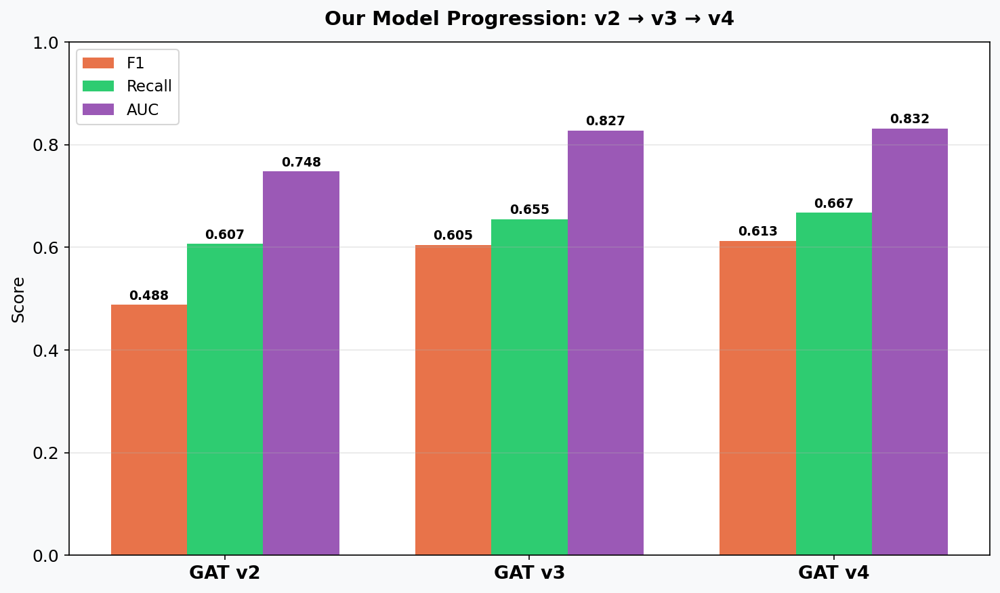

<div align="center">
<h1>🧠 EEG-GNN: Automated Seizure Onset Zone Detection</h1>
<h3>from Intracranial Electroencephalography for Improving Epilepsy Care</h3>

[](https://www.uettaxila.edu.pk/)
[](https://python.org)
[](https://pytorch.org)
[](LICENSE)
[]()
[]()
[]()
[]()

[Documentation](#-architecture) •
[Quick Start](#-quick-start) •
[Results](#-results) •
[Community](#-community) •
[Contributing](#-how-to-contribute)

</div>

---

**Drug-resistant epilepsy (DRE)** affects **30–40% of all epilepsy patients worldwide**. For these patients, accurate localization of the **Seizure Onset Zone (SOZ)** is the most critical step before surgical intervention — yet current manual analysis of intracranial EEG (iEEG) is time-consuming, subjective, and limited to specialized centers.

**EEG-GNN** is a fully automated, graph-based deep learning framework that models the brain as a functional connectivity graph and applies a **Graph Attention Network (GAT)** to detect seizure onset zones — achieving the **highest ROC-AUC (0.8315)** among all published baseline methods on the Omni-iEEG benchmark.

---

## Prerequisites

Before running EEG-GNN locally, please ensure:

- **Python 3.8 or later** installed
- **CUDA-capable GPU** (strongly recommended; 8 GB VRAM minimum)
- **16 GB RAM** minimum (32 GB recommended for full Omni-iEEG dataset)
- **PyTorch 2.0+** with matching CUDA toolkit
- **MNE-Python 1.4+** for EEG signal processing

> 💡 **Tip:** We recommend using a dedicated virtual environment (`venv` or `conda`) to avoid dependency conflicts. The project has been tested on Ubuntu 22.04 and Python 3.10. If you are on Windows, use WSL2 for best compatibility with MNE and PyTorch Geometric.

```bash
# Check your Python version
python3 --version   # should be 3.8+

# Check CUDA availability
python3 -c "import torch; print(torch.cuda.is_available())"
```

---

## 🗞️ Newest Feature — Omni-iEEG Multicenter Pipeline

The latest version of EEG-GNN scales from the single-center HUP dataset to the **Omni-iEEG multicenter benchmark** (ICLR 2026) — a standardized collection of 302 patients across 8 epilepsy centers worldwide.

The new pipeline introduces:
- **18-dimensional node features** (up from 8) including HFO proxy band power (80–300 Hz)
- **60-second sliding windows** with 50% overlap for richer temporal coverage
- **Manager-Worker fault-tolerant architecture** — processes 337 patients in parallel; individual failures do not stop the pipeline
- **Recall-constrained threshold optimization** — finds the optimal threshold satisfying Recall ≥ 0.65 before maximizing F1
Dataset:    Omni-iEEG (ICLR 2026)
Patients:   337 total → 310 successfully processed (92%)
Graphs:     13,704 generated
Features:   18-dimensional per EEG channel (node)
Window:     60 seconds · 50% overlap


*Figure: GAT model performance progression from v2 → v3 → v4 across F1, Recall, and ROC-AUC.*

---

## Why EEG-GNN

| Problem | Current Approach | EEG-GNN Solution |
|---------|-----------------|-----------------|
| **Subjectivity** | Manual visual iEEG review | Objective GAT-based prediction |
| **Scalability** | Single-center models | Multicenter Omni-iEEG (8 centers) |
| **Data leakage** | Random train/test splits | GroupKFold patient-level separation |
| **Class imbalance** | Standard Cross-Entropy | Focal Loss on minority SOZ class |
| **Missed SOZ** | Fixed 0.5 threshold | Recall-constrained search (≥ 0.65) |
| **Fragile pipelines** | Single process aborts all | Manager-Worker isolates failures |

Here are key highlights of EEG-GNN:

- 🧠 **Graph-based brain modeling** — iEEG channels as nodes, Pearson correlation as edges
- ⚡ **State-of-the-art ROC-AUC 0.8315** — surpasses TimeConv-CNN (0.8061), SEEG-NET (0.7850), CLAP (0.7684)
- 🏥 **Clinically aligned** — high Recall (0.6671) minimizes missed seizure onset zones
- 🔬 **Fully reproducible** — complete pipeline code, preprocessing scripts, result plots included
