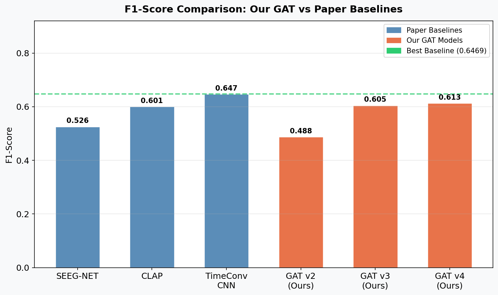
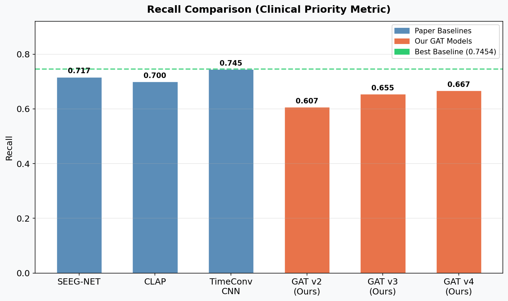
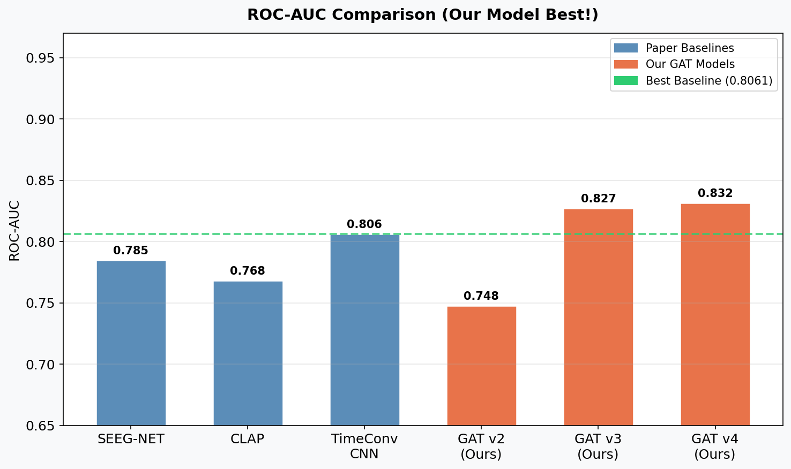
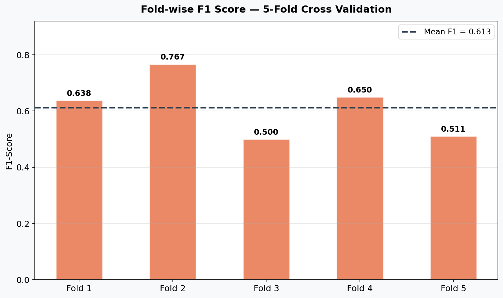
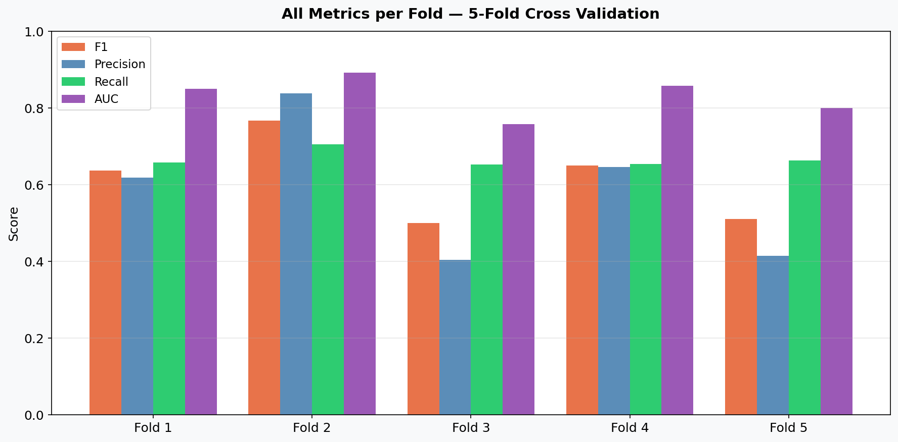
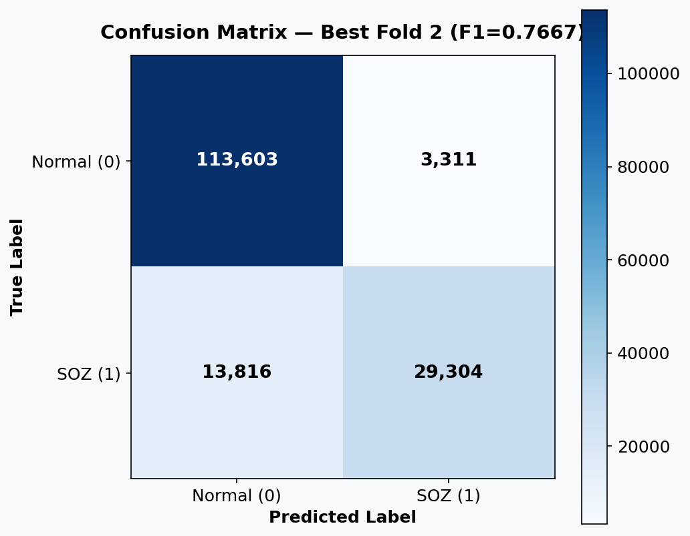

<div align="center">
<h1>🧠 EEG-GNN: Automated Seizure Onset Zone Detection</h1>
<h3>from Intracranial Electroencephalography for Improving Epilepsy Care</h3>

[](https://www.uettaxila.edu.pk/)
[](https://python.org)
[](https://pytorch.org)
[](LICENSE)
[]()
[]()
[]()
[]()

[Documentation](#-architecture) •
[Quick Start](#-quick-start) •
[Results](#-results) •
[Community](#-community) •
[Contributing](#-how-to-contribute)

</div>

---

**Drug-resistant epilepsy (DRE)** affects **30–40% of all epilepsy patients worldwide**. For these patients, accurate localization of the **Seizure Onset Zone (SOZ)** is the most critical step before surgical intervention — yet current manual analysis of intracranial EEG (iEEG) is time-consuming, subjective, and limited to specialized centers.

**EEG-GNN** is a fully automated, graph-based deep learning framework that models the brain as a functional connectivity graph and applies a **Graph Attention Network (GAT)** to detect seizure onset zones — achieving the **highest ROC-AUC (0.8315)** among all published baseline methods on the Omni-iEEG benchmark.

---

## Prerequisites

Before running EEG-GNN locally, please ensure:

- **Python 3.8 or later** installed
- **CUDA-capable GPU** (strongly recommended; 8 GB VRAM minimum)
- **16 GB RAM** minimum (32 GB recommended for full Omni-iEEG dataset)
- **PyTorch 2.0+** with matching CUDA toolkit
- **MNE-Python 1.4+** for EEG signal processing

> 💡 **Tip:** We recommend using a dedicated virtual environment (`venv` or `conda`) to avoid dependency conflicts. The project has been tested on Ubuntu 22.04 and Python 3.10. If you are on Windows, use WSL2 for best compatibility with MNE and PyTorch Geometric.

```bash
# Check your Python version
python3 --version   # should be 3.8+

# Check CUDA availability
python3 -c "import torch; print(torch.cuda.is_available())"
```

---

## 🗞️ Newest Feature — Omni-iEEG Multicenter Pipeline

The latest version of EEG-GNN scales from the single-center HUP dataset to the **Omni-iEEG multicenter benchmark** (ICLR 2026) — a standardized collection of 302 patients across 8 epilepsy centers worldwide.

The new pipeline introduces:
- **18-dimensional node features** (up from 8) including HFO proxy band power (80–300 Hz)
- **60-second sliding windows** with 50% overlap for richer temporal coverage
- **Manager-Worker fault-tolerant architecture** — processes 337 patients in parallel; individual failures do not stop the pipeline
- **Recall-constrained threshold optimization** — finds the optimal threshold satisfying Recall ≥ 0.65 before maximizing F1
Dataset:    Omni-iEEG (ICLR 2026)
Patients:   337 total → 310 successfully processed (92%)
Graphs:     13,704 generated
Features:   18-dimensional per EEG channel (node)
Window:     60 seconds · 50% overlap


*Figure: GAT model performance progression from v2 → v3 → v4 across F1, Recall, and ROC-AUC.*

---

## Why EEG-GNN

| Problem | Current Approach | EEG-GNN Solution |
|---------|-----------------|-----------------|
| **Subjectivity** | Manual visual iEEG review | Objective GAT-based prediction |
| **Scalability** | Single-center models | Multicenter Omni-iEEG (8 centers) |
| **Data leakage** | Random train/test splits | GroupKFold patient-level separation |
| **Class imbalance** | Standard Cross-Entropy | Focal Loss on minority SOZ class |
| **Missed SOZ** | Fixed 0.5 threshold | Recall-constrained search (≥ 0.65) |
| **Fragile pipelines** | Single process aborts all | Manager-Worker isolates failures |

Here are key highlights of EEG-GNN:

- 🧠 **Graph-based brain modeling** — iEEG channels as nodes, Pearson correlation as edges
- ⚡ **State-of-the-art ROC-AUC 0.8315** — surpasses TimeConv-CNN (0.8061), SEEG-NET (0.7850), CLAP (0.7684)
- 🏥 **Clinically aligned** — high Recall (0.6671) minimizes missed seizure onset zones
- 🔬 **Fully reproducible** — complete pipeline code, preprocessing scripts, result plots included
## ✨ Architecture

EEG-GNN processes raw iEEG recordings through a five-stage pipeline: data preparation, graph construction, model training, patient-level aggregation, and cross-validated evaluation.
┌──────────────────────────────────────────────────────────────────────┐
│                    EEG-GNN ARCHITECTURE                              │
├──────────────────────────────────────────────────────────────────────┤
│                                                                      │
│  📂 Raw iEEG (EDF) ──► Preprocessing ──► Windowing                  │
│       302 patients       Resample 1kHz     60s · 50% overlap         │
│       8 centers          Bandpass 1-300Hz  13,704 windows            │
│                                │                                     │
│                                ▼                                     │
│                    Feature Extraction (18/node)                      │
│              ┌─────────────────┬──────────────────┐                  │
│              │  Time-domain    │  Frequency-domain │                  │
│              │  mean, std,     │  δ θ α β γ        │                  │
│              │  skewness,      │  high-γ HFO proxy │                  │
│              │  kurtosis, RMS  │  + spectral feat  │                  │
│              └────────┬────────┴──────────────────┘                  │
│                       │                                              │
│                       ▼                                              │
│              Graph Construction                                      │
│         Nodes: EEG channels                                          │
│         Edges: Pearson correlation > 0.3                             │
│         Labels: SOZ (21.3%) vs Normal (78.7%)                        │
│                       │                                              │
│                       ▼                                              │
│  ┌────────────────────────────────────────────────┐                  │
│  │           GAT v4 (3-layer)                     │                  │
│  │   Multi-head attention                         │                  │
│  │   Skip connections + Batch normalization       │                  │
│  │   Graph context broadcast                      │                  │
│  │   Focal Loss (α=0.85)                          │                  │
│  │   3-layer MLP classifier                       │                  │
│  └────────────────────┬───────────────────────────┘                  │
│                       │                                              │
│                       ▼                                              │
│          Patient-level aggregation                                   │
│          Mean pooling over all window embeddings                     │
│                       │                                              │
│                       ▼                                              │
│          GroupKFold evaluation (5-fold, patient-level)               │
│          Recall-constrained threshold search (≥ 0.65)                │
│                                                                      │
└──────────────────────────────────────────────────────────────────────┘

For more on EEG-GNN's architecture, explore the source code in [`code/04_train_recall_gat.py`](code/04_train_recall_gat.py).

---

## 🚀 Quick Start

```bash
# Clone the repo
git clone https://github.com/Ismaelzbi-24/EEG-GNN-Seizure-Detection.git
cd EEG-GNN-Seizure-Detection

# Install dependencies
pip install -r code/requirements.txt

# Step 1: Process all patients (Manager-Worker pipeline)
python code/01_safe_runner.py

# Step 2: Merge all graph files
python code/01_merge_graphs.py

# Step 3: Train GAT v4
python code/04_train_recall_gat.py

# Step 4: Visualize results
python code/plot_results.py
```

> 💡 **Tip:** The Manager-Worker architecture processes patients in parallel and isolates per-patient failures — a crash on one patient will not stop the rest. You can safely re-run the script to resume from failed patients.

---

## 📊 Results

### Model Progression (v2 → v4)


| Version | F1-Score | Recall | Precision | ROC-AUC | Key Change |
|---------|----------|--------|-----------|---------|------------|
| GAT v2 | 0.4881 | 0.6068 | 0.4143 | 0.7477 | Node-level GAT · Cross-Entropy Loss |
| GAT v3 | 0.6050 | 0.6549 | 0.5730 | 0.8272 | 3-layer GAT · Focal Loss · graph context |
| **GAT v4** | **0.6130** | **0.6671** | **0.5845** | **🏆 0.8315** | Recall-constrained threshold |

### F1-Score Comparison


### Recall Comparison


### ROC-AUC Comparison


### Fold-wise Cross-Validation


### All Metrics Overview


### Confusion Matrix


### Per-Fold Results — GAT v4

| Fold | Accuracy | F1-Score | Precision | Recall | ROC-AUC |
|------|----------|----------|-----------|--------|---------|
| Fold 1 | 0.8627 | 0.6376 | 0.6182 | 0.6583 | 0.8495 |
| Fold 2 | 0.8722 | **0.7667** | **0.8387** | 0.7060 | **0.8924** |
| Fold 3 | 0.7387 | 0.5000 | 0.4049 | 0.6534 | 0.7575 |
| Fold 4 | 0.8555 | 0.6498 | 0.6456 | 0.6540 | 0.8582 |
| Fold 5 | 0.7718 | 0.5108 | 0.4152 | 0.6638 | 0.7997 |
| **Mean ± Std** | **0.8202 ± 0.054** | **0.6130 ± 0.099** | **0.5845 ± 0.162** | **0.6671 ± 0.020** | **0.8315 ± 0.039** |

### Comparison with Published Baselines

| Model | Type | F1 | Recall | ROC-AUC |
|-------|------|----|--------|---------|
| SEEG-NET | Segment-based | 0.5259 | 0.7169 | 0.7850 |
| CLAP | Segment-based | 0.6009 | 0.6997 | 0.7684 |
| TimeConv-CNN | Segment-based | 0.6469 | 0.7454 | 0.8061 |
| **Our GAT v4** | **Graph-based** | **0.6130** | **0.6671** | **🏆 0.8315** |

> 🏆 **EEG-GNN achieves the highest ROC-AUC (0.8315) across ALL methods** — surpassing TimeConv-CNN (0.8061). Best single fold: F1 = 0.7667.
> ## 🌟 Stay Ahead

⭐ **Star EEG-GNN on GitHub** to stay updated on new releases, dataset support, and model improvements.

[](https://github.com/Ismaelzbi-24/EEG-GNN-Seizure-Detection)

**Upcoming work:**
- 🔜 Brain Network Transformer (BNT) extension for richer long-range dependencies
- 🔜 SHAP-based attention visualization for clinical interpretability
- 🔜 Multi-label SOZ classification (resected vs preserved vs SOZ)
- 🔜 Real-time iEEG processing support
- 🔜 Web-based clinical decision support interface

---

## 💬 Community

You can join the following groups or channels to discuss or ask questions about EEG-GNN:

- 🐛 **Report a bug or request a feature** — [Open a GitHub Issue](https://github.com/Ismaelzbi-24/EEG-GNN-Seizure-Detection/issues)
- 💬 **Ask a question or start a discussion** — [GitHub Discussions](https://github.com/Ismaelzbi-24/EEG-GNN-Seizure-Detection/discussions)
- 📧 **Contact the team directly** — ismaelzabi302@gmail.com
- 🎓 **UET Taxila — Dept. of Software Engineering** — [uettaxila.edu.pk](https://www.uettaxila.edu.pk/)

> 💡 **Tip:** Before opening an issue, please check existing issues and discussions — your question may already be answered!

---

## 👥 How to Contribute

We welcome contributions from the community! If you have found a problem in EEG-GNN or want to improve the pipeline, please open a [GitHub Issue](https://github.com/Ismaelzbi-24/EEG-GNN-Seizure-Detection/issues). To contribute code please see the [Contributing Guide](CONTRIBUTING.md) and we will gladly assist with your contribution.

1. **Fork** this repository
2. **Create a branch** for your feature or fix:
```bash
git checkout -b feature/your-feature-name
```
3. **Commit** your changes clearly:
```bash
git commit -m "feat: add spectral coherence edge weights"
```
4. **Push** and open a **Pull Request**

**Good first issues:**
- Add support for additional EEG datasets (Mayo, FNUSA)
- Implement coherence-based graph edge weights
- Add SHAP-based feature importance visualization
- Write unit tests for preprocessing scripts
- Improve documentation and usage examples

---

## 📁 Project Structure
EEG-GNN-Seizure-Detection/
├── code/
│   ├── 01_safe_runner.py           # Manager: parallel patient processing
│   ├── 01_single_patient.py        # Worker: per-patient pipeline
│   ├── 01_merge_graphs.py          # Collector: merge all .pt files
│   ├── 01_process_omni_ieeg.py     # Main preprocessing script
│   ├── 01_clean.py                 # Data cleaning utilities
│   ├── 01_diagnostic.py            # Diagnostic checks
│   ├── 02_train_omni_gat.py        # GAT v2 baseline training
│   ├── 03_train_improved_gat.py    # GAT v3 with Focal Loss
│   ├── 04_train_recall_gat.py      # GAT v4 recall-constrained (final)
│   ├── plot_results.py             # Result visualization
│   ├── plot_individual.py          # Per-patient plots
│   ├── soz_app.py                  # SOZ application interface
│   ├── omni_ieeg_meta.csv          # Dataset metadata
│   └── requirements.txt            # Python dependencies
├── results/
│   └── graphs/                     # All result plots (9 figures)
│       ├── 01_f1_comparison.png
│       ├── 02_recall_comparison.png
│       ├── 04_auc_comparison.png
│       ├── 05_foldwise_f1.png
│       ├── 06_foldwise_all_metrics.png
│       ├── 08_confusion_matrix.png
│       └── 09_model_progression.png
├── .gitignore
├── processing_log.txt
└── README.md

---

## 👨‍🎓 Team

| Name | Roll No | Role |
|------|---------|------|
| **Atif Khan** | 22-SE-79 | Graph construction & preprocessing |
| **Syed Ismael** | 22-SE-95 | GAT model development & evaluation |
| **Laraib Kanwal** | 22-SE-101 | Feature extraction & visualization |

**Supervisor:** Dr. Saima Zareen — Assistant Professor, Dept. of Software Engineering, UET Taxila

> 🌟 **Notable:** Co-Supervisor Dr. Syed Muhammad Anwar is currently Principal Investigator 
> at Children's National Hospital and Associate Professor at George Washington University 
> School of Medicine. He previously served as Associate Professor (Tenured) at UET Taxila 
> and is a Fulbright Research Fellow — bringing world-class expertise in surgical planning, 
> medical imaging, and computer vision to this project.

---

## 📝 Citation

If you use EEG-GNN in your research, please cite:

```bibtex
@thesis{eeg_gnn_uet2026,
  title     = {Automated Seizure Onset Zone Detection from Intracranial
               Electroencephalography for Improving Epilepsy Care},
  author    = { Syed Ismael, Atif Khan, Laraib},
  school    = {University of Engineering and Technology, Taxila},
  department= {Department of Software Engineering},
  year      = {2026},
  type      = {Bachelor's Final Year Project}
}
```

---

## 📜 License

EEG-GNN is under the [Apache 2.0 License](LICENSE).

---

<div align="center">

**⭐ Star this repo if it helped your research!**

Made with ❤️ at **UET Taxila** — Department of Software Engineering — FYP 2026

</div>
